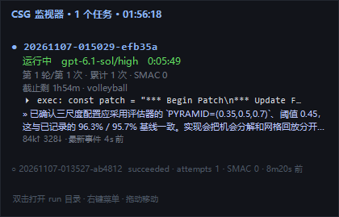

# CSG — Codex SMAC Guard

`codex exec` 遇到 `ERROR: Selected model is at capacity`（SMAC）时的自动重试 launcher，外加一个常驻桌面的实时进度仪表盘。Windows / PowerShell 7。

- **默认每轮重试 100 次**；一轮耗尽后冷却 30 分钟，再进下一轮，默认直到成功（`--max-rounds` 可限制）。
- 只把 `ERROR: Selected model is at capacity.` 且 exit code ≠ 0 判为 SMAC，任务正文里引用这句话不会误判。
- `csg status` / `csg stats` / `csg doctor` / `csg repair` / `csg run --resume` 全套；Ctrl+C 落盘退出码 130。
- **v1.2.0 起内置桌面仪表盘**：`csg run` 自动拉起置顶小窗，实时显示正在跑的 run、轮次/attempt、**SMAC 次数**、当前执行的命令、最近一条模型进展、token 与静默时长。



## 安装与用法

```powershell
# 安装（写 %USERPROFILE%\bin\csg.cmd + PATH，新终端生效）
pwsh -File .\product\csg.ps1 install

csg doctor
csg run "把当前项目的测试跑绿并修复失败项"
csg run --file .\task.md --cd C:\work\demo --model gpt-6.1-sol --effort high
csg status
csg stats
csg dash status     # 仪表盘是否已拉起（skill 要求每次启动后确认）
csg dash            # 手动拉起（run 会自动拉起；失败时补）
csg dash once       # 终端打一份实时快照，不开窗口
```

默认模型 `gpt-6-astra`、推理档 `ultra`、每轮 100 次、冷却 1800 秒、无限轮。运行数据在 `%LOCALAPPDATA%\csg`（`CSG_DATA_DIR` 可覆盖）。

## 仓库结构

```
product/        csg 本体：csg.ps1 / csg.cmd / 配置 / 说明 / 设计文档 / 回归测试
skill/          DSH skill 副本（与 %USERPROFILE%\.dsh\skills\csg\SKILL.md 同源）
docs/           入门指南、演示走查、仪表盘设计与截图
legacy/         历史独立版仪表盘原型（已被内置版取代）
_supervisor/    早期用 codex 自举开发本项目的监督脚本与任务书（历史留档）
```

## 复现验证

```powershell
pwsh -File product\tests\run-tests.ps1                      # 6/6
pwsh -File product\tests\adversarial\run-adversarial.ps1    # 16/16
pwsh -File product\tests\run-upgrade-tests.ps1              # 升级回归 5/5
```

测试脚本默认设置 `CSG_NO_DASH=1`，不会弹出仪表盘窗口；要关掉真实运行的自动拉起，用 `--no-dash`、`csg config set autoDash false` 或环境变量 `CSG_NO_DASH=1`。

## 文档

- 产品说明：[product/README.md](product/README.md)
- 设计：[product/docs/design.md](product/docs/design.md) · 审查：[product/REVIEW.md](product/REVIEW.md)
- 仪表盘实现与数据来源：[docs/dashboard.md](docs/dashboard.md)
- 入门：[docs/csg-beginner-guide.md](docs/csg-beginner-guide.md) · 演示：[docs/csg-demo-walkthrough.md](docs/csg-demo-walkthrough.md)
- 项目总览与结论：[DELIVERY.md](DELIVERY.md)

## 同步约定

本地工作副本就是仓库：`C:\Users\LLS\Pictures\lilith's card design\科技\codex_harness`，远端 `origin` 指向本仓库。任何对 csg 本体、仪表盘或 skill 的修改，都必须（1）跑一遍 `run-tests.ps1`，（2）把 `~\.dsh\skills\csg\SKILL.md` 与 `skill/SKILL.md` 同步，（3）commit + push，并用 `git ls-remote` 确认远端已有该提交。

## 数据与隐私

仓库不含任何运行日志、测试证据或账号凭据；`product/evidence/`、`_supervisor/runs/`、`_supervisor/ssh/` 等已在 `.gitignore` 中排除。仪表盘只读本地文件，不写运行数据。
